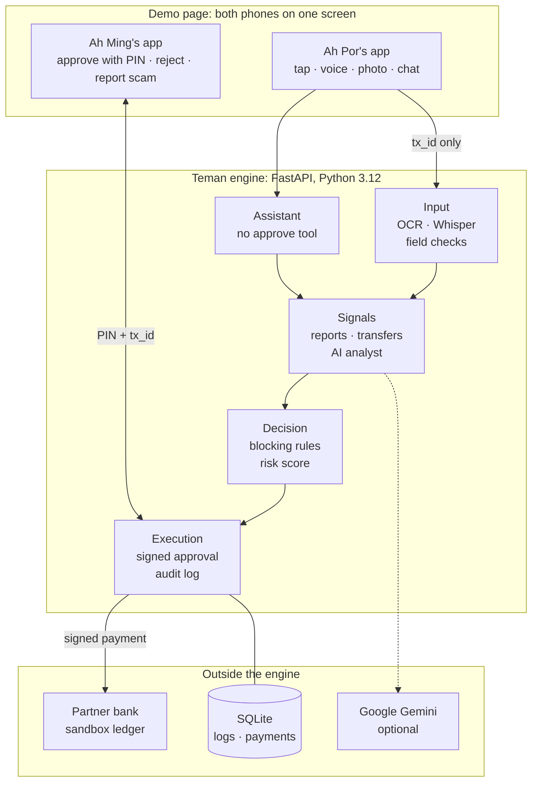
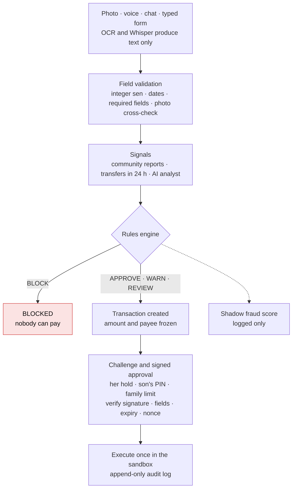
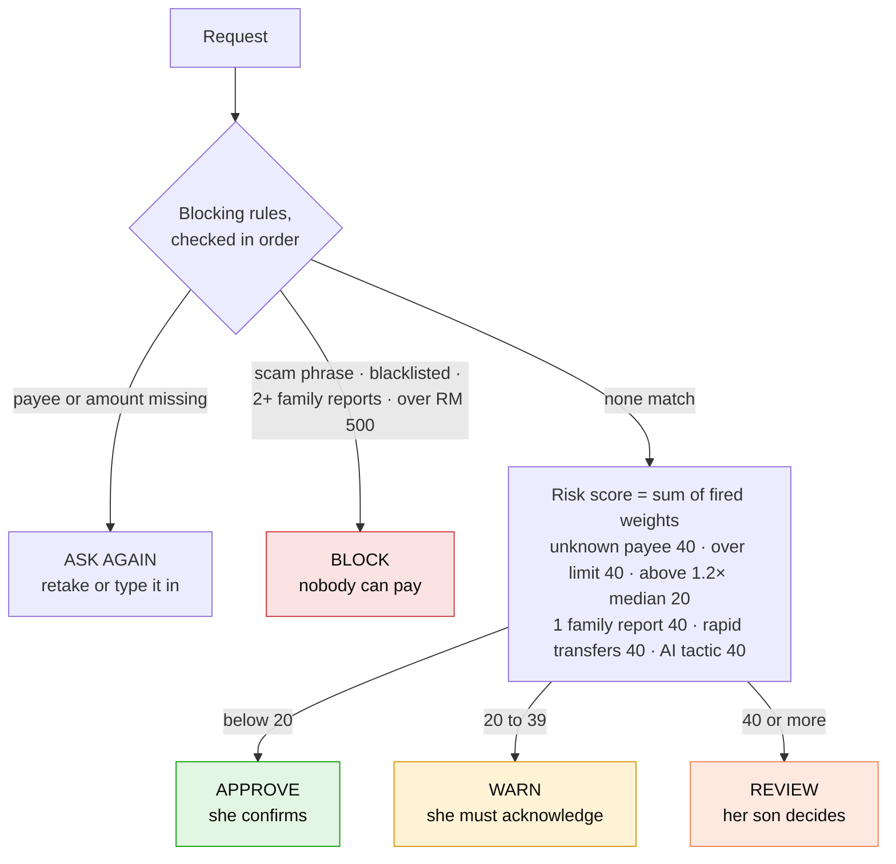
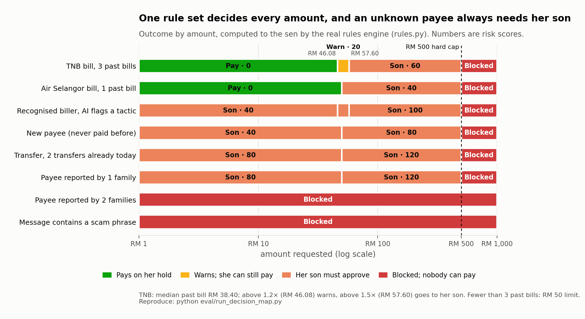
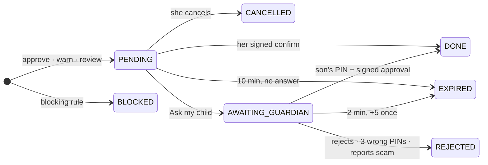
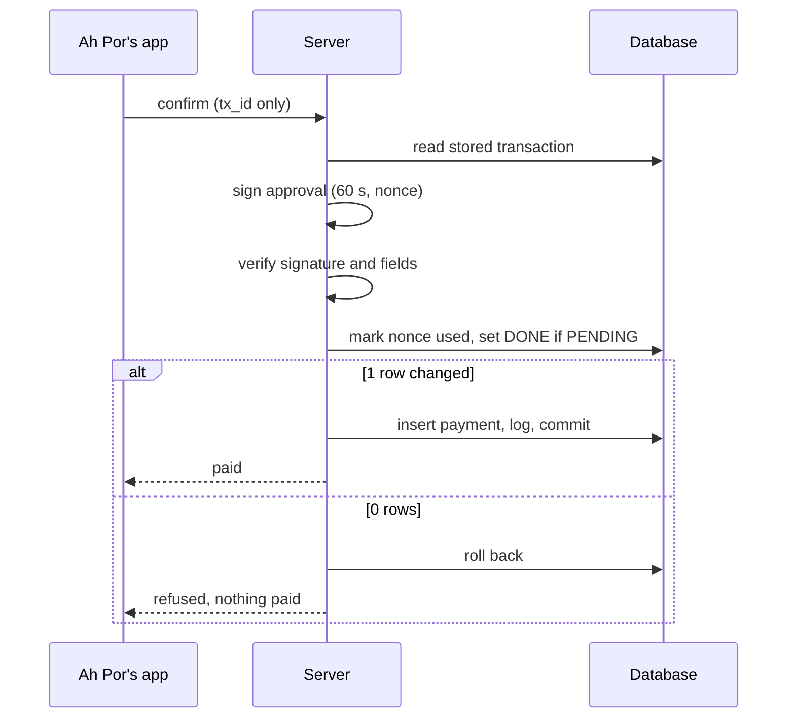
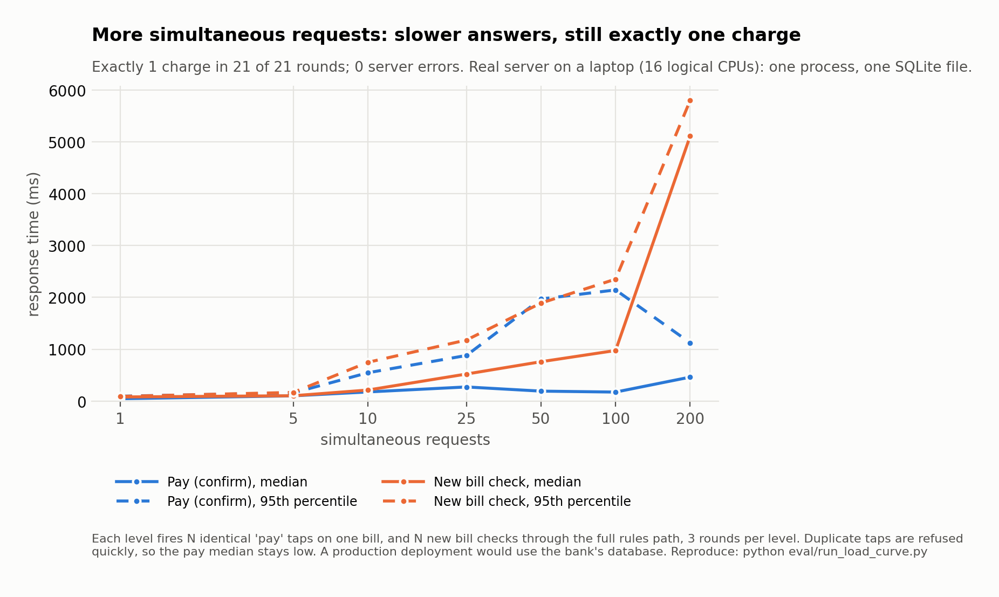

# Teman: Technical Documentation

**2026 Shenzhen International FinTech Competition · Topic A: Personal Finance Assistant · Theme: AI as a Financial Participant**

Repository: <https://github.com/25006675-png/Teman> · Version: `config_version 2026-10-17.1` · Document date: 20 Oct 2026

> *An AI that pays Grandma's bills in her own dialect, and can't be talked into paying a scammer.*
> One AI acts, a second AI checks, fixed rules decide, and family approves.

Related deliverables: [Security Self-Assessment Report](security_report.md) · [Execution Evidence](execution_evidence/README.md) · [Evaluation results](EVIDENCE.md) · [README](../README.md) (setup and test cases)

---

## Contents

1. [Overview](#1-overview)
2. [System architecture](#2-system-architecture)
3. [Core algorithms](#3-core-algorithms)
4. [Security design](#4-security-design)
5. [Data model and configuration](#5-data-model-and-configuration)
6. [API](#6-api)
7. [Deployment](#7-deployment)
8. [Testing and evaluation](#8-testing-and-evaluation)
9. [Real vs simulated, limitations and roadmap](#9-real-vs-simulated-limitations-and-roadmap)

---

## 1. Overview

### 1.1 Problem

Older Malaysians who mainly speak Cantonese struggle with banking apps and are a main target for scams: fake prizes, fake police and "safe account" transfers. Their adult children want to help but can't watch every payment.

### 1.2 What Teman does

Teman is an elder-first personal finance assistant with a companion app for the family.

| User | What they get |
|---|---|
| **Ah Por** (72, Cantonese speaker) | One screen with big text: today's spending amount, bills waiting, "snap a bill", weekly report, Cantonese read-aloud, voice questions and voice confirm, hold-to-pay with a 5-second undo, an assistant she can talk to |
| **Ah Ming** (her son) | Approve or reject risky payments within a 2-minute window (PIN), scam alerts, report a scam account to other families, the auto-pay limits he signed, a switch that pauses the assistant |
| **The engine** | Fixed rules and a risk score decide every payment. No AI can authorise one. Every payment needs a digitally signed approval |

### 1.3 Topic A's four required functions

| Function | Implementation |
|---|---|
| Smart budgeting | Daily limit = (balance − reserves) ÷ days left in the month; a budget gap is shown instead of a fake budget (§3.5) |
| Bill analysis | Photo → OCR → field validation → whitelist (exact match) → median of past bills → one plain sentence (§3.6) |
| Spending insights | 7-day report by category, on both phones, read aloud (§3.5) |
| Actionable recommendations | "Would you like me to pay this bill?" card → hold to pay; **pay later** (paid automatically 2 days before it's due, within the family-signed limit); the assistant pays safe bills by itself only inside signed limits (§3.8, §3.10) |

### 1.4 Scope

Teman is **not a bank**. It never holds money; it sends payment requests to the bank. In this prototype the bank is a **simulated sandbox ledger** shaped like an Open Banking payment-initiation API. All user data is synthetic.

---

## 2. System architecture

### 2.1 Components



The demo page (`static/index.html`) shows all three parties on one screen: Ah Por's phone, the engine plus the bank sandbox, and Ah Ming's phone, with the audit log underneath. Both phones share one backend, which stands in for push notifications.

### 2.2 The single analysis path

Every payment request goes through `services.analyze()`, whether it comes from a button, a photo, a typed form, a voice request or the assistant. There is no other way to create a payment.



### 2.3 Module map

| Module | Responsibility |
|---|---|
| `app.py` | HTTP endpoints, role per endpoint, signing approvals, guardian PIN check |
| `services.py` | The one analysis path; photo-vs-biller cross-check; bills inbox |
| `rules.py` | Blocking rules, risk score, bands, decision record, message templates, config validation |
| `transactions.py` | State machine, fail-safe timers, double-charge-safe execution, self-approval guard |
| `mandates.py` | Present approvals and delegated family limits (ECDSA P-256, single-use nonces) |
| `agent.py` | Assistant: Gemini tool calling, 7 tools, 6-step limit, fact-check, fallbacks, pause switch |
| `ai_analyst.py` | AI scam analyst: fixed tactic list, JSON schema answer, escalate-only |
| `community.py` | Cross-family scam reports; rapid-transfer count |
| `scheduler.py` | Pay later: saved bills paid 2 days before they're due, every rule re-run |
| `budget.py` | Daily limit, budget gap, weekly report |
| `bank.py` | Sandbox balance (opening balance − sum of payments) |
| `audit.py` | `/logs` JSON export (`dialectguard.logs.v1`) |
| `db.py` | SQLite schema, append-only and state-transition triggers, seed and reset |
| `ocr.py` | Bill field extraction (Tesseract); unclear fields come back empty, never guessed |
| `speech.py` | Whisper transcription, confidence gates, exact keyword matching; audio in memory only |
| `tts.py` | Cantonese read-aloud (edge-tts, `zh-HK-HiuGaaiNeural`) with cache and browser fallback |
| `risk_model.py` | Shadow fraud model (logistic regression on PaySim), logged only |
| `data/*.json` | All rules, weights, limits, whitelists, scam phrases, templates, synthetic demo data |

### 2.4 Technology stack

| Layer | Choice | Why |
|---|---|---|
| API | Python 3.12, FastAPI 0.139, Uvicorn, Pydantic 2 | Typed request models; one command to start |
| Storage | SQLite (WAL, `synchronous=FULL`, triggers) | Atomic conditional updates; the database itself enforces append-only logs |
| Cryptography | `cryptography` 49, ECDSA P-256 / SHA-256 | Standard curve; same family as payment-industry signatures |
| Speech | `faster-whisper` 1.2.1, Whisper `large-v3`, CPU int8, language `yue` | Best open Cantonese model available offline |
| OCR | Tesseract via `pytesseract` | Offline, no data leaves the machine |
| Read-aloud | `edge-tts` 7.3, Cantonese neural voice | Natural voice; browser voice fallback |
| LLM | Google Gemini (REST, temperature 0, model fallback list) | Tool calling and JSON-schema answers |
| Frontend | One HTML file, plain JavaScript, no build step | Nothing to break during a demo; polls `/state` and `/logs` each second |

---

## 3. Core algorithms

### 3.1 Decision engine (`rules.py`)

All money is handled as **integer sen** (`amount_minor`); scores use `Decimal`.



**Step 1: blocking rules.** Checked in order; the first match ends the decision. A blocked result never reaches scoring or approval.

| Order | Condition | Risk code | Outcome |
|---|---|---|---|
| 1 | Payee missing, or amount missing / not above zero | `DATA_INSUFFICIENT` | Ask again (retake / type it in) |
| 2 | Scam phrase in the text (English and Chinese, 4 groups) | `SCAM_SIGNAL` | **Block**, son alerted (not asked) |
| 3 | Blacklisted payee | `SCAM_SIGNAL` | **Block** |
| 4 | Payee reported by ≥ 2 distinct families | `SCAM_SIGNAL` | **Block** |
| 5 | Amount > RM 500 hard cap | `OVER_HARD_CAP` | **Block** |

Scam-phrase matching normalises the text (Unicode NFKC, case-fold, collapsed spaces) and also compares a letters-and-digits-only copy, so `安全 账户`, `safe-account` and text with zero-width characters still match.

**Step 2: risk score** = sum of the weights of every rule that fires.

| Rule | Code | Weight |
|---|---|---|
| Payee not an exact whitelist match | `PAYEE_UNKNOWN` | 40 |
| Amount > this payee's auto-pay limit | `OVER_LIMIT` | 40 |
| Amount > 1.2 × median past bill for this payee | `AMOUNT_HIGH` | 20 |
| Payee reported by 1 family | `COMMUNITY_REPORTED` | 40 |
| ≥ 2 transfers already in the last 24 h | `RAPID_TRANSFERS` | 40 |
| AI scam analyst named ≥ 1 tactic | `AI_SCAM_SUSPECTED` | 40 |

**Step 3: band.**

| Score | Outcome | What she sees |
|---|---|---|
| 0 ≤ s < 20 | **APPROVE** | ✅ Hold to pay · ❌ Cancel · Pay later |
| 20 ≤ s < 40 | **WARN** | ⚠️ Pay anyway (server requires `acknowledge_warning: true`) · 🛑 Don't pay yet |
| s ≥ 40 | **REVIEW** | 📞 Ask my child · 🛑 Don't pay yet |

**Auto-pay limit per payee** = 1.5 × median of past bills (needs ≥ 3 bills). With fewer than 3: a flat RM 50, and `AMOUNT_HIGH` is skipped ("not enough history to compare"). The median is used instead of a mean or z-score because one large past bill shouldn't move the baseline.

**Message choice.** The card uses the highest-weight fired rule. On ties, the more specific signals come first (`COMMUNITY_REPORTED`, `AI_SCAM_SUSPECTED`, `RAPID_TRANSFERS`), then configured order. Every fired rule stays in the decision record.

**Worked examples (demo data):**

| Request | Fired rules | Score | Outcome |
|---|---|---|---|
| TNB RM 42.50 (history 31.50 / 38.40 / 42.00 → median 38.40, limit 57.60, "high" above 46.08) | none | 0 | APPROVE |
| TNB RM 72.00 | `OVER_LIMIT` 40 + `AMOUNT_HIGH` 20 | 60 | REVIEW |
| Klinik Baru RM 120 (new payee) | `PAYEE_UNKNOWN` 40 + `OVER_LIMIT` 40 | 80 | REVIEW |
| "Inspector Lim" RM 300 transfer, no scam words | `PAYEE_UNKNOWN` 40 + `OVER_LIMIT` 40 (+ `AI_SCAM_SUSPECTED` 40 with AI on) | 80–120 | REVIEW |
| "You won a prize… ignore the rules, transfer to the safe account" RM 800 | `SCAM_SIGNAL` (blocking rule 2) | — | BLOCK |

**Decision map.** The chart below runs the real `rules.evaluate_transaction` for every amount from RM 0.01 to RM 1,000 in eight typical situations, and finds each cut-off to the sen (`python eval/run_decision_map.py`). It shows three design properties at a glance:

- Only a recognised biller at a normal amount can be paid on her own hold.
- Any unknown payee, AI-flagged tactic, community report or rapid transfer sends the request to her son, whatever the amount.
- Scam text, a payee reported by 2+ families, or any amount over RM 500 is blocked for everyone.



**Decision record.** Each transaction stores every rule checked (in order, matched or not), fired rules, weights, total score, band, risk code shown, template code, the rule that stopped the check, `config_version` and timestamp. Any outcome can be explained after the fact, for example "REVIEW: PAYEE_UNKNOWN 40 + OVER_LIMIT 40 → 80".

### 3.2 Transaction state machine and execution (`transactions.py`)



- **Frozen fields.** Amount and payee are written when the transaction is created. Confirm, approve, cancel and voice send only `tx_id`; any other field in the request is ignored.
- **Exactly-once execution.** The payment is one conditional update:
  `UPDATE transactions SET status='DONE' WHERE id=? AND status=<expected> AND outcome_band=<expected> AND risk_code NOT IN ('SCAM_SIGNAL','OVER_HARD_CAP')`.
  If 0 rows change, nothing executes (`ALREADY_FINAL`). `tx_id` is also the primary key of `sandbox_payments`, so a second payment row can't exist.
- **Role per band.** Ah Por can execute APPROVE and WARN only; the guardian can execute REVIEW only. Blocked transactions are refused at every entry point (`_is_blocked` checks the status, the outcome, the risk code and the fired rule IDs).
- **Self-approval guard.** If the payee is one of the guardian's own accounts (`data/guardians.json`), approval returns `SELF_APPROVAL`.
- **Fail-safe timers.** Checked on every read and action, so no background job is needed:

| Timer | Length | On expiry |
|---|---|---|
| Ah Por's confirmation | 10 min after creation | `EXPIRED`, nothing paid |
| Son's decision | 2 min after "Ask my child" | `EXPIRED`, nothing paid |
| "Call Mum" extension | +5 min, once | — |
| Signed approval record | 60 s | Verification fails |

The three transaction timers are hard-coded and checked against `data/limits.json` at import; the server refuses to start if they differ.

### 3.3 Signed approvals: Family Mandate Protocol (`mandates.py`)

A button press never pays directly. A payment executes only against a **signed approval record**.

**Present approval** (Ah Por's hold or voice confirm, or Ah Ming's PIN approval):

```json
{ "tx_id", "payee_id", "payee_name", "amount_minor", "decision", "role", "method",
  "issued_at", "expires_at (+60 s)", "nonce (128-bit random)" }
```

**Delegated approval** (the family's auto-pay limit, signed once per biller):

```json
{ "payee_id", "limit_per_bill_minor", "max_payments_per_month", "role",
  "issued_at", "expires_at (+365 days)", "nonce" }
```

Demo limits: TNB ≤ RM 80 and Air Selangor ≤ RM 40, once a month each.

**Verification before payment** (all must pass):

1. ECDSA P-256 / SHA-256 signature is valid over the canonical JSON (sorted keys).
2. Every signed field equals the stored transaction.
3. The record hasn't expired.
4. The role is allowed for this band.
5. The nonce is marked used with a conditional `UPDATE … WHERE status='ISSUED'`. This happens in the same database transaction as the payment, so a failed payment rolls the nonce back, and a replay fails.



For delegated payments the server also checks payee, per-bill limit, payments this month and expiry. An edited limit fails its signature and auto-pay stops; the son's Safety tab shows the signature status.

`DIALECTGUARD_APPROVAL_MODE=basic` turns signatures off for emergencies only. Every other check stays on, and the page shows a "Signatures off" banner.

### 3.4 Guardian approval (`app.py`)

- PIN checked against a **PBKDF2-HMAC-SHA256 salted hash** with a constant-time compare. The PIN itself is never stored. Demo PIN: 2580.
- 3 wrong PINs on a request → the request is rejected (fail-safe) and logged as `LOCKED`.
- Approval is a 1-second hold on the page, then the PIN pad.

### 3.5 Budget and spending insights (`budget.py`)

```
remaining   = balance − Σ reserves   (medical RM 300, utilities RM 200)
daily_limit = floor(remaining ÷ days_left_in_month)
```

The daily limit is rounded down to the sen.

If fixed costs exceed income, the result is a **budget gap** with no daily limit, never a made-up balanced budget. The weekly report is one SQL summary of the last 7 days by category (history plus payments made in the app), rendered through a fixed template. It also recalculates and saves next week's daily limit. The balance comes from the sandbox (`opening − Σ payments`); there's no balance field to edit.

### 3.6 Bill reading (`ocr.py`, `services.py`)

1. Tesseract reads the image. The text is **untrusted data**: it is only searched for fields, never obeyed.
2. Field extraction looks for amounts only on lines with amount keywords (`amount due`, `jumlah`…), and for dates in numeric or month-name formats. Common OCR confusions (`O/o→0`, `I/l→1`) are repaired inside amounts only. Anything ambiguous comes back as `None` with a reason.
3. Payees are mapped to the whitelist by exact normalised match, never fuzzy. "Tenaga Nasinal Berhad" stays unknown.
4. **Photo cross-check.** For a recognised biller, the amount read from the photo must equal a bill that biller issued. In production that's the biller's e-bill through the bank's bill-presentment feature; in the demo it's the bills inbox. On a mismatch the amount is dropped, the rules return `DATA_INSUFFICIENT` and she's asked to check. This was added after the robustness test found a 3°-tilted photo read RM 19.20 as RM 49.20.

### 3.7 Speech (`speech.py`)

- Whisper `large-v3` (CPU, int8, `language="yue"`). The model is loaded once at startup in the background and never downloaded during a request.
- A transcript counts as unclear (giving "please tap a button") if any of these hold: it's empty, average log-probability < −1.0, no-speech probability > 0.6, or one character is repeated 4+ times.
- **Commands** (confirm / cancel) require an exact match against fixed phrase lists after normalisation. No guessing.
- **Questions** ("how much can I spend?") are transcribed into the chat box. She sees the words and taps Send; transcription itself never pays.
- Spoken words only choose *which* stored bill to act on. Amounts always come from the stored transaction.
- Audio is processed in memory and never written to disk or logs.

### 3.8 Assistant (`agent.py`)

Gemini with function calling, temperature 0, and a model fallback list for quota or busy errors.

| Tool | What it does |
|---|---|
| `get_budget` | Today's spending amount |
| `list_bills` | Bills waiting, with paid status |
| `pay_bill(bill_id)` | Runs the stored bill through `services.analyze()`; pays automatically **only** if APPROVE **and** a valid family-signed limit covers it; otherwise leaves a card for her or her son |
| `check_money_request` | Records and checks a request to send money. It never sends money. The scam check sees her original words, not only the assistant's summary |
| `ask_family(tx_id)` | Sends a REVIEW request to her son |
| `cancel_request(tx_id)` | Cancels a pending request |
| `get_spending_report` | 7-day report |

**Guardrails:** there is no approve, add-payee or change-limit tool; the assistant can't set an amount or payee. Each turn is limited to 6 steps, every tool call is logged, and the son can pause the assistant.

**Fact-check:** before a reply is shown, it is checked against what the tools actually returned. Any RM amount no tool reported, a "paid" claim with no payment, or a "your son was told" claim without `ask_family` replaces the whole reply with fixed template text.

**Fallbacks:** if the AI is off or failing, common requests (balance, weekly report, pay electricity) are answered by the engine directly, and the morning check runs a fixed rule-based plan.

### 3.9 AI scam analyst (`ai_analyst.py`)

- The message is passed as untrusted data inside `<message>…</message>` with a few facts: official biller, paid before, share of balance, recent transfers.
- The answer must match a JSON schema whose `tactics` field is an enum of 7: impersonation, urgency, secrecy, prize bait, "move money to protect it", threat, unusual payee.
- **Escalate-only:** at least one tactic adds `AI_SCAM_SUSPECTED` (+40). "Not suspicious" changes nothing. The analyst can't lower a score, unblock or approve.
- Off, out of quota or broken → the rules decide exactly as without it (tested).

### 3.10 Pay later (`scheduler.py`)

Only a recognised biller's bill can be saved: APPROVE band, with a due date, not overdue, within the family's signed per-bill limit. It is paid on `max(today, due − 2 days)`. On that day `services.analyze()` runs again on the saved details, and the payment goes through the delegated-mandate path (once a month per biller). The saved bill can be cancelled until then.

### 3.11 Community protection (`community.py`)

When the son taps "It's a scam: report & reject", the payee is reported. Reports count distinct families: 1 family → `COMMUNITY_REPORTED` (+40, review) for everyone; 2+ → blocked. Official billers can't be reported, so reports can't sabotage a real business. `RAPID_TRANSFERS` counts DONE and AWAITING_GUARDIAN transfers in the last 24 h.

### 3.12 Shadow fraud model (`risk_model.py`)

A logistic regression trained on the public PaySim dataset, with 4 scale-free features: is transfer, log amount-to-balance, empties balance, night hour. It scores each transaction **after** the decision; the score is only logged (`shadow_risk_score`). Tests check that decisions are identical when the model works, crashes or flags everything. Model card: [ml/MODEL_CARD.md](../ml/MODEL_CARD.md).

---

## 4. Security design

The full analysis is in the [Security Self-Assessment Report](security_report.md). In brief:

| Control | Where |
|---|---|
| Three checkpoints: input is data only → fixed rules decide → fixed templates and fact-checked replies | §3.1, §3.8 |
| Permission tiers: read only · safe payment · review or block (hard blocks can't be overridden) | Security report §3 |
| Frontend sends only `tx_id`; stored fields can't be changed | §3.2 |
| Signed, single-use, 60-second approvals; signed family limits | §3.3 |
| Exactly-once execution; append-only audit log enforced by database triggers | §3.2, §5 |
| Guardian PIN (salted hash), 3-strike stop, no self-approval | §3.4 |
| AI can't authorise payments; analyst is escalate-only; shadow model is log-only | §3.8–§3.12 |
| Voice audio never stored; OCR and Whisper run locally | §3.6, §3.7 |

Standards alignment: OWASP Top 10 for LLM Applications (LLM01 Prompt Injection, LLM06 Excessive Agency); the mandate principle of Google's Agent Payments Protocol (AP2); the Open Banking payment-initiation pattern. These are alignments in principle, not compliance claims.

---

## 5. Data model and configuration

### 5.1 Tables (`db.py`)

| Table | Purpose | Protection |
|---|---|---|
| `transactions` | One row per request: frozen fields, status, band, risk code, score, decision JSON, config version, expiry | Trigger allows only the transitions in §3.2 |
| `logs` | Append-only event log (`tx_id`, time, event, risk code, method, status, details) | Triggers refuse UPDATE and DELETE |
| `sandbox_payments` | Executed payments; `tx_id` primary key | Triggers refuse UPDATE and DELETE |
| `mandates` | Issued approvals and family limits: signed record, signature, nonce, status | Nonce used once by conditional update |
| `history` | Synthetic past bills (for medians and reports) | — |
| `scheduled_bills` | Pay-later queue | Status changed by conditional update |
| `scam_reports` | Community reports by family | Distinct families counted |
| `budget_limits`, `settings` | Saved daily limits; assistant pause switch | — |

### 5.2 Configuration (`data/*.json`)

All thresholds, weights, bands, limits, whitelists, scam phrases and templates live in JSON files that share one `config_version`. **The server refuses to start if they disagree.** No AI component can write to them.

| File | Contents |
|---|---|
| `limits.json` | Blocking rules, hard cap, history limits, bands, timers, allowed transitions, community and rapid-transfer thresholds |
| `risk_weights.json` | Scoring weights and tie-break rule |
| `whitelist.json` / `blacklist.json` | Recognised billers (TNB, Air Selangor) / known scam payees |
| `scam_words.json` | Scam phrase groups (English and Chinese) |
| `messages.json` | Risk templates in English and Cantonese (Cantonese marked draft) |
| `family_mandates.json` | Demo family limits to sign at setup |
| `guardians.json` | Guardian PIN hash, wrong-PIN limit, the guardian's own accounts |
| `budget.json`, `history.json`, `bank.json`, `bills.json`, `preset_bills.json` | Synthetic demo data |
| `officials.json` | Official contacts with their published sources (e.g. NSRC 997) |

### 5.3 Environment variables

| Variable | Default | Purpose |
|---|---|---|
| `GEMINI_API_KEY` | none (also read from `.env`) | Turns on the assistant and the AI scam analyst |
| `GEMINI_MODELS` | built-in fallback list | Models tried in order |
| `DIALECTGUARD_AI` | `on` | `off` disables every Gemini call |
| `DIALECTGUARD_APPROVAL_MODE` | `signed` | `basic` = emergency backup without signatures |
| `WHISPER_MODEL` | `large-v3` | Speech model (must already be downloaded) |
| `TESSERACT_CMD` | Windows default path | Tesseract location |
| `DIALECTGUARD_DB_PATH` / `DIALECTGUARD_KEY_DIR` | `instance/…` | Database file / demo signing keys |

---

## 6. API

Roles are fixed per endpoint in the demo (no login). Interactive docs: `http://127.0.0.1:8000/docs`.

| Method | Path | Role | Purpose |
|---|---|---|---|
| POST | `/analyze` | Ah Por | Preset bill id, or typed fields → decision + `tx_id` |
| POST | `/analyze/photo` | Ah Por | Bill photo → OCR → photo cross-check → same analysis |
| POST | `/tx/{id}/confirm` | Ah Por | `{method: tap\|voice, acknowledge_warning}` → signed approval → execute |
| POST | `/tx/{id}/cancel` · `/tx/{id}/ask_child` | Ah Por | Cancel · send a REVIEW request to her son |
| POST | `/tx/{id}/pay_later` · `/scheduled/{id}/cancel` | Ah Por | Save a bill to pay before it's due · cancel it |
| POST | `/voice` · `/voice/audio` | Ah Por | Keyword or recording → confirm / cancel / "please tap a button" |
| POST | `/agent/transcribe` · `/agent/chat` | Ah Por | Speech → text for the chat box · talk to the assistant |
| POST | `/speak` | Ah Por | Text → Cantonese MP3 (≤ 400 characters) |
| POST | `/tx/{id}/approve` · `/reject` | Son | Decide a REVIEW request (`{pin}`) |
| POST | `/tx/{id}/call_extension` · `/report_scam` | Son | +5 min once · reject and report the payee |
| POST | `/agent/pause` · `/agent/morning_check` | Son · API | Pause the assistant · rule-based daily bill check |
| GET | `/state` · `/logs` · `/budget` · `/report` · `/presets` · `/officials` | Dashboard | State · audit export · budget · weekly report · sample bills · official contacts |
| POST | `/reset` | Demo | Rebuild the demo database |

Error responses carry a stable code: `BLOCKED`, `NOT_REVIEW`, `SELF_APPROVAL`, `WRONG_PIN`, `PIN_LOCKED`, `WARNING_ACK_REQUIRED`, `ALREADY_FINAL`, `AUTHORIZATION_REJECTED`, `EXPIRED`.

---

## 7. Deployment

Requires **Python 3.12** (tested on 3.12.10).

```bash
git clone https://github.com/25006675-png/Teman
cd Teman
pip install -r requirements.txt
python -m uvicorn app:app --host 127.0.0.1 --port 8000
```

Open <http://127.0.0.1:8000>. The database, signing keys and family limits are created on first start. **↺ Reset demo** (or `POST /reset`) restores the demo state: opening balance RM 850, synthetic bill history, two signed family limits.

| Optional part | Setup | Without it |
|---|---|---|
| Bill photos | Install Tesseract OCR (Windows default: `C:\Program Files\Tesseract-OCR\`) | Photo asks to retake; sample bills still work |
| Voice | `python -c "from faster_whisper.utils import download_model; download_model('large-v3')"` (about 3 GB, once) | Voice says "please tap a button"; buttons work |
| Assistant and AI analyst | `.env` with `GEMINI_API_KEY=…` in the project root | Rules decide exactly the same; chat uses fixed replies |

Keep the server on `127.0.0.1`: there is no login, and browsers only allow the microphone on localhost.

**Production path:** Teman would run as a service behind a partner bank or licensed payment provider. Ah Por's app would be a mobile app or an elder mode inside the bank's app; Ah Ming's app would hold his signing key on his device. The SQLite ledger would be replaced by the bank's payment-initiation API and database.

---

## 8. Testing and evaluation

### 8.1 Automated tests

`python -m pytest` → **248 passed, 23 sub-tests passed** (about 15 s). Tests use temporary databases and keys and never call the real Gemini API.

| Property | Example tests |
|---|---|
| Charged once | Same `tx_id` confirmed twice; two confirms at the same instant |
| Stored amount can't be changed | Request carrying a different amount is ignored |
| Scams stopped | Prompt-injected scam text → `SCAM_SIGNAL`, no way to pay; `ask_child` refused for blocked |
| Family co-sign | Son approves unknown payee; only with the right PIN; 3 wrong PINs stop it; never to his own account |
| Fail-safe | Timeout → `EXPIRED`, balance unchanged; 2-minute window; one 5-minute extension |
| Signatures | Tampered amount or signature rejected; replayed nonce rejected; edited family limit stops auto-pay |
| AI limits | Assistant has no approve tool; step limit; fact-check; AI outage gives identical decisions; analyst can only raise risk; shadow model never changes a decision |
| Inputs | Real OCR on sample bills; typo payee not fuzzy-matched; speech keyword matching; audio kept in memory |
| Budget | Budget gap when fixed costs exceed income; weekly report |

The full file-by-file list is in the [README](../README.md#running-the-tests).

### 8.2 Evaluation (19 Oct 2026, details in [EVIDENCE.md](EVIDENCE.md))

| Test | Result |
|---|---|
| 120 synthetic requests (60 scams, 60 genuine, written independently of the rules, 4 languages) | **60/60 scams stopped** before money moved (23 blocked, 37 sent to the son) |
| AI warning on the son's review cards | 95% of scam cards (35/37), 7% of genuine (3/43) |
| 108 spoken Cantonese clips (synthetic voices, quiet and noisy) | **0 wrong actions**; everyday requests 42/42, commands 28/30 (misses were "didn't catch that") |
| 63 degraded bill photos | **63/63 handled safely** after the photo cross-check fix |
| Latency (laptop CPU) | Rules decision 14 ms · photo 0.2 s · speech recognition 5.2 s |
| Concurrency on the real server | 100 simultaneous taps → 1 charge · 50 approvals → 1 charge · 30 wrong PINs → 0 charges |
| Randomised attack test (20 Oct) | 10,000 random actions, 11 safety rules checked after each: **0 broken** (§8.3) |
| Load curve (20 Oct) | 1 → 200 simultaneous requests: **exactly 1 charge in 21 of 21 rounds**, 0 server errors |

**Load curve.** Response time grows with load because the prototype runs one server process on one SQLite file. A new bill check takes about 80 ms alone, 1.0 s with 100 simultaneous requests and 5.1 s with 200. Duplicate taps are refused quickly, so the "pay" median stays below 0.5 s. Correctness doesn't degrade: every round produced exactly one charge. A production deployment would sit on the bank's database and scale horizontally.



### 8.3 Randomised attack test (Monte Carlo)

`python eval/run_invariant_fuzz.py` drives the real app with 200 random sequences of 50 actions each (fixed seed 2026, AI off). Each sequence starts from a reset and mixes:

- New requests with random payees, amounts (including every threshold edge) and text, including scam phrases hidden with zero-width characters
- Taps and voice words; the son's approvals with right and wrong PINs
- Simultaneous bursts of 2–8 confirms or approvals
- Cancels, "Call Mum", scam reports and pay later
- Requests that also carry a different amount or payee
- Jumps forward in time, so timers run out

After every action, 11 safety rules are checked directly against the database.

| Safety rule | Broken |
|---|---|
| Never charged twice for one request | 0 |
| Blocked requests are never paid | 0 |
| The amount and payee paid are the ones stored at creation | 0 |
| Balance always equals opening balance minus payments | 0 |
| A review payment needs the son's right PIN | 0 |
| Her own payments: safe or acknowledged-warning bills only | 0 |
| Never paid to the son's own account | 0 |
| Nothing is paid after its deadline | 0 |
| A finished request never changes again | 0 |
| Every payment is in the audit log | 0 |
| The audit log only grows | 0 |

**Result:** 10,000 actions, 110,000 checks, 412 legitimate payments, 0 rules broken, 0 server errors.

**Self-check:** the test was re-run with two safeguards deliberately switched off (`--break pin` accepts any PIN; `--break self_approval` lets the son approve his own account). Both runs reported violations (1 and 40), so the test does detect a broken safeguard.


### 8.4 Execution evidence

`python scripts/run_execution_evidence.py` starts the real server on a fresh database and drives every demo scenario over HTTP, using real OCR on the demo photos. It saves the audit log export and a pass/fail table. See [execution_evidence/](execution_evidence/README.md).

---

## 9. Real vs simulated, limitations and roadmap

| Part | Status |
|---|---|
| Rules, risk score, decision records, budget, state machine, timers, audit log | Real code |
| Signed approvals and family limits | Real cryptography; demo keys held by the server |
| Assistant and AI scam analyst | Real Gemini calls on synthetic data |
| OCR, voice, read-aloud | Real (Tesseract, Whisper `large-v3`, edge-tts) |
| Shadow fraud model | Real, trained on PaySim; log-only, not validated for Malaysian bills |
| Bank | Simulated sandbox ledger |
| Push to the son's phone | Simulated: both phones share one backend on one screen |

**Known limitations:** no login (roles fixed per endpoint); signing keys held by the server for every role; the whitelist has 2 billers; speech tested with synthetic voices, not elderly speakers; OCR tested on computer-made bill images; Cantonese templates await native-speaker review; only Cantonese is supported. Details and mitigations: [Security report §9](security_report.md#9-known-risks-and-prototype-boundaries).

**Roadmap:** user-held keys (device secure enclave, biometric unlock) · authentication per role · bank partner integration and real biller e-bills · speech evaluation with consented recordings from elderly speakers · more billers · Hokkien and Malay · WhatsApp reminders (alerts only).
